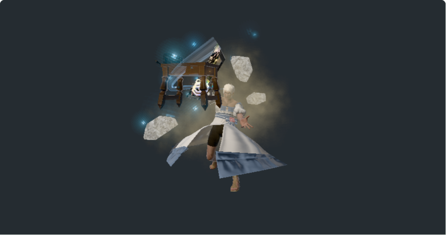

# 从 Action ID 播放动作与特效

Web SDK 接收内容寻址清单，不需要访问游戏安装目录。离线工具 `icexiv-action` 读取 `Action → ActionTimeline → TMB`，展开 C002，并保留每次 C010 动作引用和 C012 特效触发。导出不会把同一路径的两次发射合并成一个实例。`nix build .#action-import` 或以下 Cargo 命令均可构建，无需相邻的源码检出。



这是 `examples/action.html` 的浏览器实绘：重播后固定推进 30 个 60 Hz 步。两手持械和飞石组合用于同时检查角色蒙皮、武器挂点和技能粒子；这里使用预览端点，不代表游戏允许以此装备施放飞石。

```sh
# 离线，从自己的游戏安装读取；两个导出器可以共用 objects/
cargo run --release --locked --manifest-path effects/tools/Cargo.toml -- --pack "$GAME/game/sqpack" \
  119 objects --actor 101 > stone.json
cargo build --release --locked --manifest-path effects/Cargo.toml --example export
echo 17180398476 | effects/target/release/examples/export "$GAME/game" objects > weapon.json
```

`--actor 101` 选择 c0101 的基础 SKLB；导出器沿命令的 TMB 路径在对应武器动作目录中探测 PAP，并检查 `bt_common/resident/action.pap`。只有 PAP **确实包含请求的记录名**时才采用。可在 `--actor 101` 后列出明确的 PAP 路径代替探测。缺失的名称列入 `unresolvedClips`；不会拿记录 0 代替。无需骨动画时可省略 `--actor`。导出结果含逻辑路径到 SHA-256 的 `files`、PAP 名称映射、时间线 ID 和入口。只写入输出 CAS，不修改游戏。

在 c0101 上导出 Action `9, 15, 31, 42, 53, 75, 97, 113, 119, 120, 127, 133, 141, 163, 25860`，共得到 55 次 C012、22 次 C010、33 份不同 AVFX。对 22 次动作引用分别调用 WASM 的 `SkeletonClip.loadNamed`，在起始、时长 37%、末帧读取左右手，132 份矩阵均为有限值。这项检查覆盖资源闭包和骨帧，不等同于 15 项技能全部通过视觉对照。

```js
// read(logicalPath, sha256) 返回校验过的 Uint8Array。
await element.openEffect(weapon, read);
const warnings = await element.playActionBundle(stone, preview, read);
// 更新 C012 第二端点。position 和每个 ElementId 的矩阵均以世界坐标表示。
await element.setActionTarget({
  target: {origin: 2, kind: 0, id: -1},
  position: [0, 0, -2],
  elements: [],
});
// 停止技能后，恢复原来的常驻特效开关。
await element.stopAction();
```

`preview` 提供时间单位、条件轨道选择，以及每个绑定对象的变换或 ElementId。`effects/examples/stone-scene.json` 还显式提供主飞石的方向查询结果，和普通目标原点不同；这些是可复验的预览输入，不是采集的客户端状态。飞石的两条子命令都引用 `cmcn_shoot1c.avfx`，但分别使用武器与副手对象。PAP 记录名为 `cbbm_mgc_cnj_3b`。只有一个可见武器部件不表示另一个绑定目标也应放在同一坐标。

`setActionTarget` 替换指定第二端点的完整快照。已存在的 Document 在下一个正时长输入前提交新目标；暂停重绘不会消耗更新。新出生的 Document 直接使用最新快照。若同一步还有相机或施法者 ElementId 的变化，先在旧年龄刷新这些姿态，再用新目标推进一次。是否跟随变化仍由 AVFX Binder 的查询与缓存语义决定。

### C012 控制器

`visibility` 的低三位不是显示开关。`1` 为每次发射单独分配外部控制器，`2` 绕过创建时的一项资格判断，`4` 在宿主查到状态位 32 时请求结束命令。`0..7` 的组合均支持。宿主以清单 `effects[]` 的 occurrence 下标提供运行时结果，不按 AVFX 路径复用：

```js
// 播放前放进 preview.controllers。保留外部尾部，直到宿主报告 ready。
preview.controllers = [{occurrence: 0, manager_ready: false}];
// 播放中：完整替换此 occurrence 的输入；未传字段取默认值。
await viewer.setActionController({occurrence: 0, state_32: true, manager_ready: false});
await viewer.stepScene(1);
const state = await viewer.actionControllerStatus(0); // phase、trigger_requests、trigger_attached
await viewer.endActionCommands();                    // 停止新命令；已分离的 Document 可继续绘制
await viewer.setActionController({occurrence: 0, manager_ready: true});
await viewer.stepScene(1);                            // 下一个正时长输入回收尾部
```

`allocation_available` 默认 true；`eligible` 默认 null（未进入该回调）；`context_code` 默认 0。只有实际回调为 false、`context_code != 198` 且没设掩码 2 才因该项资格失败。`state_32` 默认 false，包含对象表、转换和状态查询均成功的条件。`manager_ready` 默认 true 是预览器的快速回收策略，不是从粒子数或资源名推断的游戏完成时刻。外部控制器在命令结束时请求首个 Scheduler 的触发槽 1，解除命令所有权；直到回收仍可采样，但旧 occurrence 的 `triggerAction/fadeAction` 已不可用。`finished` 会等待尾部回收。`replayEffect` 重置 occurrence 状态并恢复初始控制输入；`stopAction` 或换一套动作直接销毁这次动作预览及其尾部。native 对应 `ActionPlayer::{set_controller_input, controller_status, end_commands}`。

非空 `enabled_tracks` 会明确指定要播放的条件轨道。要按 TMTR 表达式选择飞石子轨道，设 `preview.enabled_tracks = []`，并传 `preview.condition_inputs = {variables: {"268435497": 35}}`。值 35 通过轨道 4，值 42 通过轨道 3；C010 与 C012 使用同一份宿主变量快照。未提供所需变量时会报告缺项，不推测角色状态。

生成 SDK 后，从同一静态服务器打开：

```text
examples/action.html?owner=/weapon.json&action=/stone.json&preview=/effects/examples/stone-scene.json&objects=/objects/
```

要在同一画面显示着装角色和副手，可用相同的 CAS 导出：

```sh
cargo run --manifest-path effects/Cargo.toml --release --example export_actor -- \
  "$GAME/game" objects effects/examples/c0101-actor.json > actor.json
echo 4295037913 | effects/target/release/examples/export "$GAME/game" objects --owner > offhand.json
```

在示例 URL 后追加 `&actor=/actor.json&offhand=/offhand.json`。`--owner` 只打包武器模型与绑定骨架，适用于没有常驻特效的副部件；有常驻特效的盾可用普通 `export`。副手使用自己的 ElementId 表、驻留粒子和光环材质。

可用 `node effects/tools/verify-action-browser.mjs "$URL" frame.png` 在 Chromium WebGPU 中复验这套组合。它比较同一模拟帧在不同角色位置的像素，然后从相同种子重播并检查随机状态与整张画布是否恢复。

`motion=off` 可只验收 C012 发射。`playActionBundle` 的第四个参数设为 `false` 等价。主动选择只看特效时，不读取 PAP 和角色 SKLB。挂点和曝光需要场景输入；运行期诊断由组件的 `renderwarning` 提供。WebGPU 需要 HTTPS 或 localhost。

用 `pauseScene()` 冻结角色、常驻挂载和技能时钟，仍可旋转相机。`await stepScene(1)` 前进一个 60 Hz 模拟步（每次可传 1–6），`resumeScene()` 恢复实时播放。暂停后先 `await replayEffect()` 再逐步推进，可从出生帧复查。

例如剑术 Action 9 的两个 C010 起点为 0 和 11，第一段时长 12；按预览时钟，两段重叠一个时间单位。宿主可显式设置 `preview.crossfade_clips = true` 在这段交集里按两条动作各自的局部时钟混合姿态。嵌套、同时起始或三段重叠仍需宿主选择轨道，不将这种预览过渡视为客户端的自动权重规则。

native 可使用 `ActionPlayer::load`、`EffectPlayer::play_action` 和 `frame_with_host`。已有解包目录的离线命令、逐帧诊断和独立验收脚本见仓库 `effects/tools/action-preview.md`。目前预览使用显式条件选择和时间窗口；不能从一条 Action 行推断战斗目标、角色状态或技能取消时点。

有战斗事件输入的宿主可以调用 `triggerAction(occurrence, scheduler, trigger)`，或对常驻挂载使用 `triggerResident(ownerMdlPath, scheduler, trigger)`；调度器序号从 0 开始，触发槽从 1 开始。`fadeAction(occurrence, scheduler, frames, mode)` 可发出淡入（1）、淡出（2）、淡出并停止普通发射（3）。按命令出现序号寻址，因此同一路径的另一只手不受影响。方法返回 Promise；已退场的实例返回 `false`，未支持的播放状态会报错。重播清除外部事件历史。

## 与实机比对时要保留的输入

主手、副手和技能的粒子构造与更新共用一条四字随机流。`await element.replayEffect([w0,w1,w2,w3])` 设置初始快照并重播全场，`await element.randomState()` 读取当前四个无符号 32 位字。不传参数会重用初始种子；只结束动作、重播常驻或替换副手不会倒退其他实例的随机流。相同种子仍需相同的外部事件和更新顺序才能复现画面。

`target: "actor"` 的 C010 播放会在每个模拟步把两只已装配武器的 MDL ElementId 交给相应的施术者武器绑定（ID 为 `-1`），然后更新技能粒子。没有常驻 AVFX 的武器同样使用其 MDL 和 SKLB。只指定 `weaponBinding` 时按指定端点更新；未装配的副手和命令指定的特殊绑定点仍由宿主提供。

- **方向挂点不是目标原点。** 飞石 Linear Goal `BPTP=2` 使用目标场景对象的方向查询。`directional_goals` 和 `setDirectionalGoal` 接受按 occurrence、binder、ordinal 标识的完整仿射矩阵（可含剪切）。查询失败传 `missing: true`，不传矩阵；没有提供查询器时会报告后备路径。实测飞石出生时查询失败不会补发，已出生后查询失败保留上次成功结果。
- **战斗轨道不是无条件顺序表。** 预览可接受宿主选定的条件、两端对象和事件，控制器的资格、状态位和完成时刻由独立宿主输入提供。每次 C012 发射独立使用命令 RGBA，即使共享同一 AVFX；RGB 与资源的 `RvR/G/B` 相乘，alpha 独立应用。低三位以外的未知控制器标志会诊断并跳过；非默认 TRS 与非单位宿主的组合可提供最终 `command_frames`。原生消费证据在 `effects/tools/c012-evidence.md`。
- **最终像素还取决于场景。** 资产没有记录某一实机帧的曝光纹理、战斗目标的绘制对象或所有环境光参数。验收逐帧一致性需要同版本、同动作、同相机的参考，以及该帧的目标与场景输入。读出资源、通过合成测试或画出相近轮廓，都不能单独证明全库还原。
