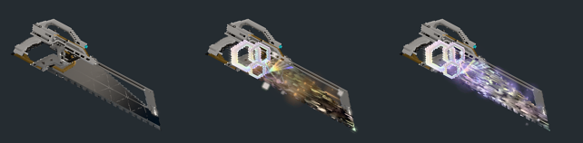

# 渲染支持范围：以群星手锯为例

群星手锯（51778）的主要遮挡问题出在绘制端：粒子有深度测试，且运行时已经生成了锯刃和光环，但绘制时把贴近表面的发光层向锯身后方推。武器外框还需要宿主启用 IMC 指定的子网格。这两项都不需要重写 AVFX 解析器。

从左至右：关闭、0.8 秒、4 秒，native 同机位输出。可用[游戏外观参考](https://ffxiv.consolegameswiki.com/wiki/File:Saw_of_Stars.jpeg)核对三个六边形、锯背外框和发光锯刃。参考画面含角色与游戏光照；环的透明度、锯刃的亮度和配色不作逐像素一致保证。

## 手锯的特效由什么组成

用[原生导出器](weapon-effects.md)读取本机客户端：主部件 `17180398476` 的宿主是 `w5004b0008.mdl`，挂载 `chara/weapon/w5004/obj/body/b0008/vfx/eff/vw0004.avfx`；副部件 `4295037913` 单独导出为 `null`。主挂载实际读到 12 个 ATEX 和宿主骨架。AVFX 包含 1 个调度器、7 条时间线、7 个发射器、3 个内嵌模型，粒子定义如下（下标从 0 开始）：

| 粒子定义 | 类型 | 资产声明的混合与深度 |
| --- | --- | --- |
| 0–2 | LightModel，发光网格 | 依次为乘色、滤色、加法；只有 2 写深度 |
| 3、6 | Powder，粉尘 | 均为加法；3 启用软粒子 |
| 4、5、7、8 | Quad，面片 | 加法，不写深度 |
| 9–11 | Model，网格粒子 | 普通混合，均启用软粒子，不写深度 |

**四组都开启深度测试。** 不写深度表示该层不挡住后画的片元，不表示它能穿过锯身。软粒子还会根据与场景表面的深度差淡出。12 个是文件里的定义数，不是某一帧应当同时看见的层数。

## 谁负责修什么

| 责任层 | 手锯上的证据 | 支持情况 |
| --- | --- | --- |
| `icexiv-data`：读资源和求值 | IMC 属性掩码、MDL ElementId、SKLB、AVFX 和 ATEX 均可读取。固定姿态下第 48、240 帧均有三份锯刃网格实例和锯柄两侧各三枚光环 | 手锯的 Bind 只有常量 `SpS`。在旋转、平移和非均匀缩放宿主的对照中，六个环的位置、方向和尺寸随 `n_hara` 更新。见[动态挂点校验](motion.md) |
| `icexiv-renderer`：组装武器宿主 | `atr_bv_b`、`atr_bv_a` 是两个带属性的子网格；IMC 变体 4 的属性掩码为 `0x3ff`，默认的空掩码会隐藏两者 | native 和 Web 的武器入口均把所选变体的掩码传入模型准备阶段，使外框参与颜色和深度绘制 |
| 绘制核心 `xiv-companion-render` 与 SDK 适配 | 核心相机使用正向深度（近处数值小，`LessEqual`）；shader 把 `DpOf` 加到裁剪空间 Z。直接传入手锯的正偏移会把贴面特效推远 | SDK 在创建播放实例时转换偏移方向，保留原始资产、深度测试、深度写入及软粒子。升级核心时应核对 `vfx.wesl::apply_depth_offset`，避免二次取反 |
| 绘制核心：色调与合成 | 前向粒子片元按 `bATM` 和逐帧场景参数改变 RGB，不改变 alpha，独立于 bloom | `setParticleTone(tX,tW,centerRed)` 提供曝光输入；未提供时使用中性预览。公式、适用变体和实测边界见[客户端亮度证据](particle-tone.md) |

**区分遮挡和漏发射。** `snapshot` 以 256 × 256、yaw 0、pitch 0、zoom 3.2 连续推进。保持宿主模型和 `DsDt`/`DsDw` 不变，只改变偏移方向，第 240 帧相对于各自关闭特效的基线从 2031 个变化像素变为 6271 个，锯刃和光环显现。这是隔离偏移的对照，不是覆盖率。应用 IMC 显隐后同一机位为 6027 个。验收应直接看三环轮廓、沿刃光带与锯背框架，不能以变化像素越多越好。

复现：按[原生快照说明](weapon-effects.md)导出主部件 `17180398476`，运行 `snapshot saw.json objects saw-frames 0 0`；最后两个参数是 yaw、pitch（弧度）。用 `3.14 0` 检查另一面，用 `1.57 0` 检查窄边。浏览器通过 `openEffect` 加载同一导出清单。

## 哪些能力可以依赖

| 路径 | 已有能力 | 使用边界 |
| --- | --- | --- |
| 装备 `EquipmentViewer` | LOD 0、材质基色和色表 diffuse；带匹配 SKLB／PAP 时支持蒙皮、跳帧和播放 | 不透明颜色预览；玻璃、染色、法线、金属反射不能按游戏效果验收。见[装备模型预览](README.md) |
| 武器宿主 `openWeapon` | 按实际 IMC 变体加载 MDL、材质和 AVFX，保留 ElementId 与骨架；宿主与粒子共用相机和深度。材质 UV 按独立时钟滚动 | 可以由指定角色骨帧和持握矩阵驱动武器。预览用单位持握矩阵，不保证匹配所有武器和动作 |
| 常驻粒子 | 60 Hz 求值；有面片、内嵌网格、折线、投影贴花和模型表面 Aura 绘制路径；按层的深度标志、混合和优先级绘制 | 支持取决于节点配置及宿主输入。Aura 仅提交可无歧义选择的活动资源；有贴图和绘制路径不保证曲线、绑定、排序或最终像素与游戏一致 |
| 触发与诊断 | 可开关、重播 IMC 挂载，按导入的 TMB 命令和显式场景输入预览技能特效 | 条件轨道、目标选择和时钟需要宿主上下文。`renderwarning` 不是所有不支持字段的汇总；清单无警告也不是视觉验收 |

依据：SDK 的 `effects/src/lib.rs`、`effects/src/web.rs` 和 `web/component.js`；[`icexiv-data` 的 AVFX 解析与字段默认值](https://github.com/icexiv/icexiv-data/blob/7fa1b24b9cac1b9892e8f6cdf290eb857fc9c08d/src/formats/avfx/parser.rs)；本地 `effects/scene/src/renderer/model/` 的 `context.rs`（多批次排序、深度与软粒子）、`vfx.rs`（粒子批次与混合）、`options.rs`（材质与后处理）。源码基线及更新方式见 `effects/scene/UPSTREAM.md`。这些能力和样本快照不能换算成全库视觉还原率。
